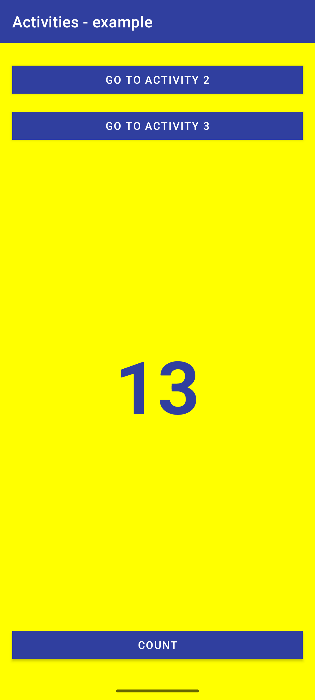
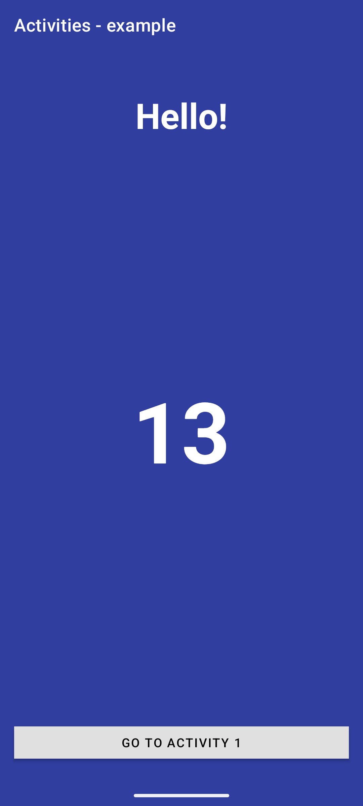
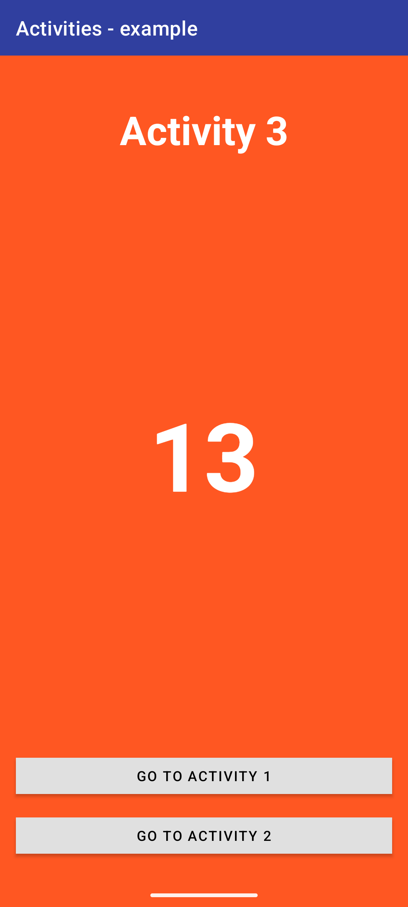

# Activities Example

An Android application demonstrating multi-activity navigation, state management across activity transitions, and custom layout styling using ConstraintLayout.

## Features

- Multi-Activity Navigation: Seamless intent-based navigation between three separate activities.
- Shared State Management: Preserves and passes counter state across activity transitions using Intent extras and saved instance states.
- Clean Layout Architecture: Customized user interfaces for each activity built with ConstraintLayout and Material Design components.
- Fullscreen UI: Configured with custom MaterialToolbar headers and fullscreen layout handling.

## Screenshots

| MainActivity | HelloActivity | ThirdActivity |
| :---: | :---: | :---: |
|  |  |  |

## Activity Overview

### 1. MainActivity
- Primary entry point of the application.
- Yellow background theme.
- Features a counter increment button ("COUNT") at the bottom.
- Includes navigation buttons to launch Activity 2 ("HelloActivity") and Activity 3 ("ThirdActivity").

### 2. HelloActivity
- Secondary activity.
- Solid blue background theme.
- Displays a "Hello!" header along with the current counter value.
- Provides a navigation button ("GO TO ACTIVITY 1") to return to the primary activity.

### 3. ThirdActivity
- Tertiary activity.
- Solid orange background theme.
- Displays an "Activity 3" header along with the current counter value.
- Provides navigation buttons to transition to either Activity 1 or Activity 2.

## Technical Details

- Language: Java
- Minimum SDK: 24 (Android 7.0)
- Target SDK: 37 (Android 15+)
- UI Framework: Android XML Layouts with ConstraintLayout and MaterialComponents
- Lifecycle & State: Manages Intent extras, `onNewIntent`, and `onSaveInstanceState` for robust counter state retention across configuration changes and navigation flows.

## Building the Project

1. Clone the repository.
2. Open the project in Android Studio.
3. Sync Gradle project files.
4. Run the app on an Android device or emulator.
